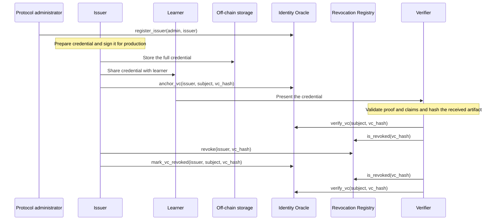

# Issuer onboarding guide

A university, bootcamp, training provider, or employer becomes a trusted issuer
when the protocol administrator registers its Stellar address in the Identity
Oracle. The issuer attests to a learner's achievement in a verifiable credential
(VC). The learner receives the credential and can share it with a verifier.

Keep the full credential off-chain. The Identity Oracle stores its SHA-256 hash
under the learner's address, along with the issuer address, ledger timestamp,
and revocation flag. The Revocation Registry separately records revocation by
hash. A verifier checks both contracts and verifies the credential off-chain.

## Prerequisites

- Use Bash from the repository root. On Windows, use WSL with the tools installed
  inside it, or Git Bash with the tools available on its PATH.
- Keep the same Bash session as you work through the commands. Stop if a command
  fails and check the error before continuing.
- Install [Stellar CLI](https://developers.stellar.org/docs/tools/cli).
  The repository lists CLI 21+ as a prerequisite. The commands below use CLI
  27.1.0. Check your version with `stellar --version`.
- Install Python 3 for byte-for-byte hashing. If deploying your own contracts,
  install Rust stable and its `wasm32v1-none` target.
- Use Stellar testnet with funded accounts for transaction fees. You need the
  testnet contract IDs for `identity-oracle` and `revocation-registry`. Use an
  existing deployment or create an isolated one below.

## Create testnet identities

For the isolated demo, create three disposable identities. The CLI's `--fund`
option uses testnet Friendbot. Choose fresh aliases if these already exist.

```bash
ADMIN_KEY=educhain-demo-admin
ISSUER_KEY=educhain-demo-issuer
LEARNER_KEY=educhain-demo-learner

stellar keys generate "$ADMIN_KEY" --network testnet --fund
stellar keys generate "$ISSUER_KEY" --network testnet --fund
stellar keys generate "$LEARNER_KEY" --network testnet --fund

ADMIN_ADDRESS=$(stellar keys address "$ADMIN_KEY")
ISSUER_ADDRESS=$(stellar keys address "$ISSUER_KEY")
LEARNER_ADDRESS=$(stellar keys address "$LEARNER_KEY")
```

A `*_KEY` variable holds a local CLI identity alias for `--source-account`. A
`*_ADDRESS` variable holds the corresponding public `G...` address for contract
arguments. Keep the CLI-managed keys out of the repository. For an existing
deployment, set the issuer and learner variables using your testnet identities.
The protocol administrator supplies their own signing identity and public
address in their shell for registration.

## Choose a deployment

### Use an existing deployment

Ask the protocol administrator for the two initialized testnet contract IDs and
approval to register your issuer public address. The `CXXX...` values in the
README and [deployment file](../deployments.testnet.json) are placeholders.

```bash
read -r -p 'Identity Oracle testnet contract ID: ' IDENTITY_ID
read -r -p 'Revocation Registry testnet contract ID: ' REVOCATION_ID
```

Share the same contract IDs with your verifier. Proceed to registration without
running the initialization commands.

### Deploy an isolated testnet instance

The [deployment script](../scripts/deploy.sh) builds and deploys all three
contracts, then overwrites `deployments.testnet.json`. Its Wasm paths use
`wasm32-unknown-unknown`. CLI 27.1.0 builds under `wasm32v1-none`, so run the
build and deploy steps directly for the two contracts this guide uses. This
leaves the checked-in deployment file intact. The Credit Oracle is only needed
for scoring.

```bash
rustup target add wasm32v1-none
stellar contract build --locked --package identity-oracle
stellar contract build --locked --package revocation-registry

IDENTITY_ID=$(stellar contract deploy --network testnet \
  --source-account "$ADMIN_KEY" \
  --wasm target/wasm32v1-none/release/identity_oracle.wasm)
REVOCATION_ID=$(stellar contract deploy --network testnet \
  --source-account "$ADMIN_KEY" \
  --wasm target/wasm32v1-none/release/revocation_registry.wasm)
```

Initialize each fresh instance with your demo administrator. Run each call
once, immediately after deployment. The supplied administrator authorizes
initialization and becomes the stored administrator.

```bash
stellar contract invoke --network testnet --id "$IDENTITY_ID" \
  --source-account "$ADMIN_KEY" --send=yes -- initialize \
  --admin "$ADMIN_ADDRESS"
stellar contract invoke --network testnet --id "$REVOCATION_ID" \
  --source-account "$ADMIN_KEY" --send=yes -- initialize \
  --admin "$ADMIN_ADDRESS"
```

## Register the issuer

The Identity Oracle's administrator runs this command using the approved issuer
address. In the isolated demo, use the administrator and issuer created above.

```bash
stellar contract invoke --network testnet --id "$IDENTITY_ID" \
  --source-account "$ADMIN_KEY" --send=yes -- register_issuer \
  --admin "$ADMIN_ADDRESS" --issuer "$ISSUER_ADDRESS"
```

After the transaction succeeds, the address is registered and the contract
emits `IssReg`. An administrator address that differs from the stored one
returns `NotAuthorized`. Supplying the correct address still requires that
administrator's authorization, so an issuer cannot register itself.

For every write in this guide, wait for confirmed transaction success before
continuing. If the RPC reports a pending submission or the CLI times out, use
the transaction hash to check its final status before retrying.

## Prepare the credential

Save the example as `credential.json` in a local directory outside the
repository. Replace the two example public addresses with the values of
`ISSUER_ADDRESS` and `LEARNER_ADDRESS`, keeping the
`did:stellar:testnet:` prefix. Use only synthetic course and learner data.

```json
{
  "@context": [
    "https://www.w3.org/ns/credentials/v2",
    {
      "ex": "https://example.org/credentials#",
      "CourseCompletionCredential": "ex:CourseCompletionCredential",
      "courseName": "ex:courseName"
    }
  ],
  "type": ["VerifiableCredential", "CourseCompletionCredential"],
  "issuer": "did:stellar:testnet:GAIRCEIRCEIRCEIRCEIRCEIRCEIRCEIRCEIRCEIRCEIRCEIRCEIRCF6M",
  "validFrom": "2026-05-08T00:00:00Z",
  "credentialSubject": {
    "id": "did:stellar:testnet:GALROFYXC4LROFYXC4LROFYXC4LROFYXC4LROFYXC4LROFYXC4LRPFOD",
    "courseName": "Introduction to Data Analysis"
  }
}
```

This unsigned test fixture uses the [VC Data Model 2.0][vc-model] shape.
`issuer` identifies the organization, `credentialSubject.id` identifies the
learner, and `validFrom` records when the credential becomes valid. The custom
type and `courseName` express the course completion claim.

For production, issue the VC with a compatible signing tool and proof format
before computing its hash. The repository supplies no VC signing or full
proof-validation workflow. The verifier must resolve the issuer's verification
method, check the signature, and evaluate the learner, claims, and validity
under its own trust policy.

See the [DID method specification](did-spec.md) for publishing verification
methods. DID document anchoring is part of DID setup and is optional for this
demo. `anchor_did` requires the subject's authorization and checks the CID's
prefix and length. `anchor_vc` works without a DID document anchor.

Store the credential in access-controlled storage and share it with the learner
and authorized verifiers. A public IPFS upload can expose its contents. Keep
student records off testnet and out of public storage.

## Hash and anchor the credential

Use the path to the credential file you saved when prompted. Python reads its
exact bytes and outputs a 32-byte SHA-256 digest as 64 hexadecimal characters.

```bash
read -r -p 'Path to credential.json: ' CREDENTIAL_FILE
VC_HASH=$(python3 - "$CREDENTIAL_FILE" <<'PY'
import hashlib
import pathlib
import sys

print(hashlib.sha256(pathlib.Path(sys.argv[1]).read_bytes()).hexdigest())
PY
)
printf '%s\n' "$VC_HASH"
```

On Windows, use `python` or `py -3` if that is how Python 3 is installed. Hash
the final artifact after signing for production. Whitespace changes and JSON
reserialization can change the bytes and the digest. Supply the verifier with
the exact artifact, or agree on a canonicalization method before issuance. The
repository defines no canonicalization method. Reuse the digest for anchoring,
verification, and revocation.

The registered issuer signs the anchor transaction. Pass the plain hex digest,
without a `0x` prefix, for the Soroban `BytesN<32>` input.

```bash
stellar contract invoke --network testnet --id "$IDENTITY_ID" \
  --source-account "$ISSUER_KEY" --send=yes -- anchor_vc \
  --issuer "$ISSUER_ADDRESS" --subject "$LEARNER_ADDRESS" --vc_hash "$VC_HASH"
```

A confirmed transaction appends a non-revoked anchor and emits `VCAnch`. Check
the anchor before resubmitting a timed-out transaction to avoid duplicate
records.

## Verify the anchor and status

A verifier uses the learner's address, the hash of the received credential bytes,
and the trusted deployment's contract IDs. The demo uses the learner's funded
account as the simulation source. A verifier can substitute their own funded
testnet public address. `--send=no` simulates the call without signing or
submitting a transaction.

```bash
stellar contract invoke --network testnet --id "$IDENTITY_ID" \
  --source-account "$LEARNER_ADDRESS" --send=no -- verify_vc \
  --subject "$LEARNER_ADDRESS" --vc_hash "$VC_HASH"
stellar contract invoke --network testnet --id "$REVOCATION_ID" \
  --source-account "$LEARNER_ADDRESS" --send=no -- is_revoked --vc_hash "$VC_HASH"
stellar contract invoke --network testnet --id "$IDENTITY_ID" \
  --source-account "$LEARNER_ADDRESS" --send=no -- is_verified --subject "$LEARNER_ADDRESS"
```

Before revocation, expect `true`, `false`, and `true` respectively for a
successful isolated run. `verify_vc` confirms a matching active anchor for the
subject. It does not return the issuer address or validate the credential proof.
`is_revoked` also returns `false` for an unknown hash, so use both status
checks alongside off-chain verification.

## Revoke the credential

Use the original issuer's signing identity and public address. First revoke the
hash in the Revocation Registry, then update the matching Identity Oracle
record. The registry requires the supplied address's authorization. It does
not check the trusted issuer list or establish who issued the credential.

```bash
stellar contract invoke --network testnet --id "$REVOCATION_ID" \
  --source-account "$ISSUER_KEY" --send=yes -- revoke \
  --issuer "$ISSUER_ADDRESS" --vc_hash "$VC_HASH"
stellar contract invoke --network testnet --id "$IDENTITY_ID" \
  --source-account "$ISSUER_KEY" --send=yes -- mark_vc_revoked \
  --issuer "$ISSUER_ADDRESS" --subject "$LEARNER_ADDRESS" --vc_hash "$VC_HASH"
```

Repeat the three reads above. For the isolated demo with one anchor, expect
`verify_vc` to return `false`, `is_revoked` to return `true`, and `is_verified`
to return `false`. A successful `mark_vc_revoked` transaction can leave the
credential unchanged if no record matches both the issuer and hash. The two
writes are independent. If only one succeeds, check both states and complete
the remaining write with the same issuer, subject, and hash as applicable.

`is_verified` stays true if the learner has another active credential.
`get_active_vc_count` counts active records, while `get_total_vc_count` and its
legacy alias `get_vc_count` also count revoked records. Deregistration prevents
future anchoring but leaves existing credentials in place. Score inputs are
[updated separately](scoring-spec.md#all-vcs-revoked).

## Sequence of calls



## Contract calls

The `admin`, `issuer`, and `subject` parameters are Soroban `Address` values.
`vc_hash` is `BytesN<32>`, and `did_doc_cid` is a `String`. The CLI needs a
simulation source for read-only calls, which require no contract authorization.

### Identity Oracle

| Function | Parameters in order | Authorization |
| --- | --- | --- |
| `initialize` | `admin` | Supplied admin |
| `register_issuer` | `admin`, `issuer` | Stored admin |
| `anchor_did` | `subject`, `did_doc_cid` | Subject |
| `anchor_vc` | `issuer`, `subject`, `vc_hash` | Registered issuer |
| `mark_vc_revoked` | `issuer`, `subject`, `vc_hash` | Supplied issuer |
| `verify_vc` | `subject`, `vc_hash` | Read-only |
| `is_verified` | `subject` | Read-only |
| `get_active_vc_count` | `subject` | Read-only |
| `get_total_vc_count` | `subject` | Read-only |
| `get_vc_count` | `subject` | Read-only |

`initialize` stores the first administrator, and `register_issuer` registers
the issuer's address. The optional `anchor_did` stores the DID document CID.
`anchor_vc` appends an active anchor. `mark_vc_revoked` flags records for the
subject that match both the hash and issuer.

`verify_vc` returns a `bool` for an active anchor matching the hash.
`is_verified` returns a `bool` for any active anchor for the learner. The
three count methods return `u32` values. `get_active_vc_count` counts active
anchors, and `get_total_vc_count` and `get_vc_count` include revoked anchors.

### Revocation Registry

| Function | Parameters in order | Authorization |
| --- | --- | --- |
| `initialize` | `admin` | Supplied admin |
| `revoke` | `issuer`, `vc_hash` | Supplied issuer |
| `is_revoked` | `vc_hash` | Read-only |

`initialize` stores the first administrator. `revoke` flags the hash as
revoked and records the supplied issuer. `is_revoked` returns a `bool` for
whether the registry flags the hash as revoked.

## Troubleshooting

- For a missing or unfunded account, run
  `stellar keys fund "$ISSUER_KEY" --network testnet` with the affected alias.
- If the contract is missing, check its ID and network. A testnet reset can
  remove an existing instance.
- If registration reports `not initialized`, initialize your fresh Identity
  Oracle or ask the administrator to check their instance. `AlreadyInitialized`
  means the instance already has an administrator.
- For `NotAuthorized` or a transaction authorization failure, check the stored
  admin or original issuer address. The signing alias must resolve to the
  required public address.
- For `IssuerNotRegistered`, ask the stored admin to register the exact issuer
  address on this Identity Oracle and wait for confirmation.
- For an invalid hash length or unexpected `false` anchor lookup, check that
  the digest has 64 hex characters and recompute it from the original file.
  Confirm the learner address, contract ID, and network.
- If a write fails, times out, or is pending, check the CLI error and look up
  the transaction hash with [Stellar RPC `getTransaction`][rpc-transaction].
  Wait for `SUCCESS` or diagnose `FAILED` before retrying.
- If the revocation reads disagree, check both transactions and confirm the
  original issuer, subject, and digest. Complete the missing write and rerun
  both status checks.

## References

- [README](../README.md) and [architecture](architecture.md)
- [Stellar DID method](did-spec.md)
- [Identity Oracle](../contracts/identity-oracle/src/lib.rs) and
  [Revocation Registry](../contracts/revocation-registry/src/lib.rs)
- [Stellar CLI documentation](https://developers.stellar.org/docs/tools/cli)
- [W3C Verifiable Credentials Data Model 2.0][vc-model]

[vc-model]: https://www.w3.org/TR/vc-data-model-2.0/
[rpc-transaction]: https://developers.stellar.org/docs/data/apis/rpc/api-reference/methods/getTransaction
